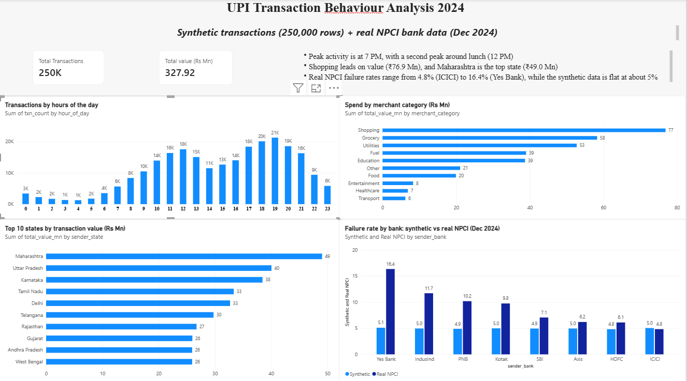

# UPI Transaction Behaviour Analysis (2024)

**Tools:** MySQL, Power BI | **Skills:** SQL (JOIN, GROUP BY, CASE, window functions), data cleaning, dashboarding

An end-to-end SQL and Power BI analysis of 250,000 UPI transactions, combined with real NPCI bank-level data to test how far synthetic data can be trusted for bank-level conclusions.

## Project goal

Use SQL to answer business questions about UPI usage (when, what, where and how often payments fail), then present the results in a Power BI dashboard.

## Data

| Dataset | Type | Details |
|---------|------|---------|
| UPI transactions 2024 | **Synthetic** (Kaggle) | 250,000 rows, 17 columns, 1 Jan to 30 Dec 2024 (31 Dec is not in the source file). [Kaggle link: add here] |
| Bank-wise statistics, Dec 2024 | **Real** (NPCI) | UPI Ecosystem Statistics, Top 50 member performance, remitter banks. Filtered to 8 banks: SBI, HDFC, ICICI, IndusInd, Axis, PNB, Yes Bank, Kotak |

NPCI publishes only aggregate statistics, not individual transactions, so a synthetic transaction-level dataset was used for the detailed analysis and the real NPCI table was used for comparison.

## Approach

1. Checked the transaction file for nulls, duplicates and consistency (hour, day and weekend columns match the timestamps).
2. Cleaned the NPCI file to 8 banks and matched bank names to the transaction data.
3. Loaded both datasets into MySQL (`transactions`, `bank_stats`).
4. Wrote 8 SQL queries, each with a question and a finding (see `upi_analysis.sql`).
5. Exported key results as CSV and built a Power BI dashboard.

## Key findings

- **Peak time:** 7 PM is the busiest hour (21,232 transactions). There is a smaller lunch peak around 12 PM. The 6 to 8 PM window holds about 24% of all transactions; 4 AM is the quietest hour.
- **Transaction types:** P2P 44.98%, P2M 35.06%, Bill Payment 14.95%, Recharge 5.01%.
- **Categories:** Shopping leads by value (Rs 76.86 Mn), followed by Grocery (Rs 58.28 Mn) and Utilities (Rs 52.74 Mn); these three make up about 57% of value. Education has the highest average ticket (Rs 5,094).
- **States:** Maharashtra leads (Rs 49.04 Mn, about 15% of value); the top 5 states make up about 59%.
- **Age groups:** Ages 26 to 35 are the largest group (about 35% of value).
- **Synthetic vs real failure rates (key finding):** In the synthetic data, failure rates are flat at about 5% for every bank. Real NPCI data for Dec 2024 shows failure rates from **4.83% (ICICI) to 16.35% (Yes Bank)**. Synthetic data cannot be used to judge bank-level reliability.
- **No weekend effect:** about 685 transactions per day on weekdays vs 686 on weekends.

## SQL queries

| # | Question | Techniques |
|---|----------|------------|
| 1 | Busiest hours of the day | GROUP BY |
| 2 | Synthetic vs real failure rate by bank | JOIN |
| 3 | Transaction type mix | Window function (SUM OVER) |
| 4 | Spend by merchant category | GROUP BY |
| 5 | Top states by value | RANK() window function |
| 6 | Failure rate by amount band | CASE |
| 7 | Behaviour by sender age group | GROUP BY |
| 8 | Weekday vs weekend activity | CASE, COUNT(DISTINCT) |

## Limitations

- The transactions are **synthetic**. Flat patterns across banks, ages, weekdays and transaction types reflect how the data was generated, not real user behaviour.
- The real NPCI data covers **one month** (December 2024) and 8 banks only.
- "Real failure %" is calculated as 100 minus the approved %, so it includes both business and technical declines.
- The failure rate rises slightly with amount (4.87% to 5.76%), but the gap is under 1 percentage point and the top band has only 1,805 transactions, so it is a weak trend.
- `fraud_flag` was not analysed: only 480 transactions are flagged (about 0.19%) and the rate shows no pattern across segments.

## Repository contents

- `upi_analysis.sql`: all queries with comments and findings
- `UPI_Dashboard.pbix`: Power BI dashboard
- `dashboard.png`: dashboard screenshot
- `data/`: NPCI bank statistics (`bank_stats_dec2024.csv`) and exported query results

## How to reproduce

1. Download the transaction CSV from the Kaggle link above.
2. Create a MySQL database named `upi_project` and load the data (setup commands are in the commented block at the top of `upi_analysis.sql`).
3. Load `data/bank_stats_dec2024.csv` as the table `bank_stats`.
4. Run the queries in `upi_analysis.sql` and open `UPI_Dashboard.pbix`.

## About

Priya Prasad | [LinkedIn](https://linkedin.com/in/priya-prasadd) | [GitHub](https://github.com/Priya-prasadddd)
